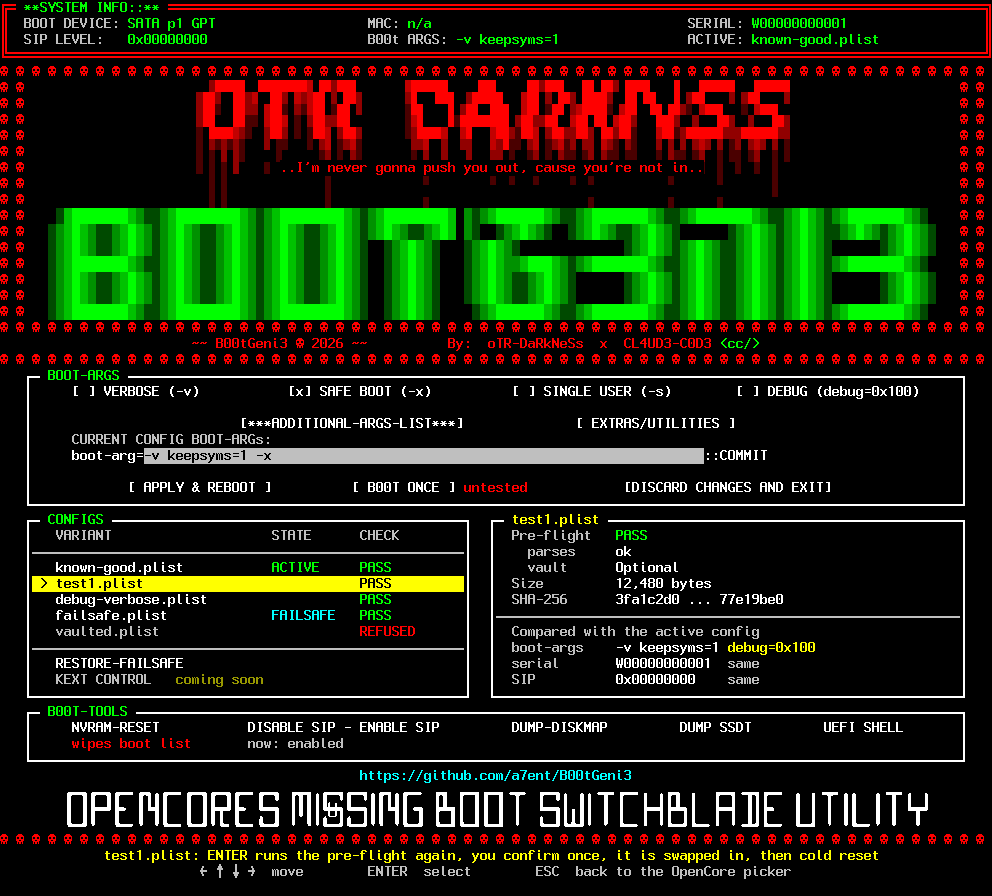

# B00tGeni3

**OpenCore's missing boot switchblade utility.** A UEFI tool you start from the OpenCore picker
(`EFI\OC\Tools\B00tGeni3.efi`). It swaps in a different `config.plist`, edits boot-args, and runs a few
recovery tools, then sends you back to the picker or does a cold reset.

~~ B00tGeni3 ☠ 2026 ~~ By: oTR-DaRkNeSs x CL4UD3-C0D3 `<cc/>`

> Status: **0.8g, tested in QEMU (OVMF + OpenCore 1.0.8) only.** Not yet run on real hardware.
> Use it on a machine you can recover with a USB installer or a second EFI.



## What it does

- **CONFIGS**: lists every `*.plist` in `EFI\OC\B00tGeni3\` (up to 9, `known-good.plist` first) and marks the
  one that matches the live `config.plist` as ACTIVE.
- **Swap**: pick a variant, the pre-flight checks it, you confirm once, it is swapped in, then a cold reset.
  1. The current config is backed up to `B00tGeni3\config.plist.bak`.
  2. The new one is written to `config.tmp` and read back.
  3. Renames put it in place, and it is read back again.
  4. There is always a complete config on disk.
- **RESTORE-FAILSAFE**: one key back to `known-good.plist`.
- **Pre-flight**: a variant is refused, with every reason shown, unless all of these hold:
  - OpenCore's own parser accepts it.
  - `ShowPicker` is true.
  - `B00tGeni3.efi` is still an enabled Tools entry.
  - Every enabled Drivers / Kexts / ACPI / Tools file exists.
  - The vault check passes (see below).

  A config that fails any of these could stop OpenCore before the picker, where this tool can't be
  reached to switch back.
- **BOOT-ARGS**: toggles for `-v -x -s debug=0x100`, a list of documented boot-args with short descriptions,
  and a free edit line.
  - **COMMIT** saves the line to `config.plist`.
  - **APPLY & REBOOT** saves it and cold resets.
  - **B00T ONCE** only sets NVRAM `boot-args` and goes back to the picker. It is *untested with a real macOS
    boot*. Whether it really lasts one boot depends on your config's NVRAM > Delete.
- **B00T-TOOLS**: NVRAM reset, SIP toggle, disk map dump, SSDT dump, UEFI Shell.

## Vault (0.8g)

OpenCore checks every file it loads against `EFI\OC\vault.plist` whenever that file exists, even with
`Vault = Optional`. If a key is patched into `OpenCore.efi`, it also needs `vault.sig` to match. Any
mismatch stops OpenCore **before the picker**.

So a variant that needs a vault brings its own set, signed on your Mac:

```
EFI\OC\B00tGeni3\NAME.plist   the config
EFI\OC\B00tGeni3\NAME.vault   vault.plist made for that config
EFI\OC\B00tGeni3\NAME.vsig    vault.sig for NAME.vault
```

The tool **never signs**.

**Pre-flight checks for a variant's set:**
- the set's signature against the key in `OpenCore.efi`
- that its `config.plist` entry matches the variant
- every file under `EFI\OC` against the vault, both ways

**Swap with a set:**
1. It backs up `config.plist`, `vault.plist` and `vault.sig`.
2. It writes all three as temp files and verifies them.
3. It renames them into place, and rolls back on error.

### Signing on the Mac: `tools/vault-sign.py`

OpenCore's `sign.command` makes a new key on every run, so it can only ever sign one config. This
helper keeps one key and signs every variant with it:

```sh
python3 tools/vault-sign.py keygen ~/b00tgeni3-key /path/to/RsaTool   # once; keep the private key OFF the ESP
python3 tools/vault-sign.py embed OpenCore.efi OpenCore-signed.efi ~/b00tgeni3-key/vault-pub528.bin
python3 tools/vault-sign.py sign  /Volumes/EFI/EFI/OC ~/b00tgeni3-key   # after ANY change under EFI\OC
python3 tools/vault-sign.py check /Volumes/EFI/EFI/OC ~/b00tgeni3-key
```

Keep these in mind:
- **Any change to any file under `EFI\OC` makes every set stale, `known-good` included.** That means
  a kext update, a new tool build, or a Resources change. Until you re-sign, the tool refuses them all.
- **With a vault active, COMMIT and APPLY & REBOOT are refused**, because an edited config can't be
  signed on the ESP. B00T ONCE still works.
- **A power cut during the three renames can stop OpenCore before the picker.** Recovery then needs
  a USB installer.

## Build

Built as an OpenCorePkg application (tested with OpenCorePkg 1.0.8, XCODE5 toolchain, X64):

1. Copy `Application/B00tGeni3/` into an OpenCorePkg 1.0.8 tree.
2. Apply `patches/OpenCorePkg.dsc-b00tgeni3.diff`, which adds one line to `OpenCorePkg.dsc`.
3. Build the module:
   ```sh
   cd OpenCorePkg/UDK && source edksetup.sh
   build -a X64 -b RELEASE -t XCODE5 -p OpenCorePkg/OpenCorePkg.dsc -m OpenCorePkg/Application/B00tGeni3/B00tGeni3.inf
   ```
4. The output is `UDK/Build/OpenCorePkg/RELEASE_XCODE5/X64/B00tGeni3.efi`.

## Install

1. Copy `B00tGeni3.efi` to `EFI\OC\Tools\`.
2. Add a Misc > Tools entry for it (Path `B00tGeni3.efi`, Enabled, `Auxiliary` as you like) to every
   config you will swap between.
3. Put the variants in `EFI\OC\B00tGeni3\`, with `known-good.plist` being one you know boots.
4. Keep a USB installer or a second EFI that boots.

## Bench (`bench/`)

These are the QEMU scripts the gates were run with: OVMF from MacPorts qemu, raw FAT32 ESP images, and
keys and screenshots sent through the QEMU monitor. They assume the original workspace layout (master
ESP folders `bench/ESP` and `bench/ESP-vault`, OpenCorePkg build under `phase0/`), so treat them as a
reference. `bench/CHANGES.txt` lists every build with its sha256.

## Docs

- `docs/evidence/`: gate evidence for each phase (bench runs, screenshots named there, fault tests).
- `docs/phase7-vault-design.md`: what OpenCore does with the vault (read from the 1.0.8 source) and the design.
- `docs/phase8-spec.md`: the UI and feature spec.
- `docs/drafts/`: the A2 screen design, plus vault UI drafts V1 and V1b. These are not built yet.

## Known gaps

- Nothing has run on real hardware yet. Firmware FAT drivers differ from OVMF's.
- B00T ONCE has not been tried with a real macOS boot.
- A power cut mid-swap can leave FAT damage or temp files. The next swap clears the temp files; use
  Disk Utility First Aid for the FAT damage.
- The vault swap's tool-side gate run (refusals on screen, swap round trip, power cut) is in progress.
